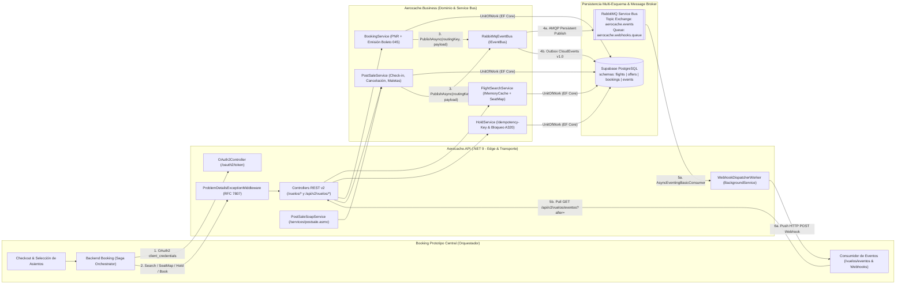
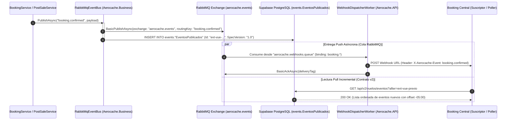

# ✈️ AEROCACHE Airlines (EQ10 — `NODE_VUE_EQ10`) | Microservicio GDS de Vuelos v2.0

Sistema empresarial de microservicios para búsqueda de vuelos, mapa de asientos en tiempo real, bloqueo temporal de tarifas y asientos (*Hold*), emisión de reservas (*Bookings*) y boletos electrónicos IATA (`045-XXXXXXXXX`), operaciones postventa (check-in digital, pases de abordar QR, cambio de asiento/fecha, equipaje extra y cancelaciones), bus de eventos (**RabbitMQ Service Bus + Transactional Outbox CloudEvents v1.0**) y coexistencia multi-protocolo (**REST OpenAPI v2 + SOAP 1.1/1.2 WSDL**).

🌐 **Producción en vivo (Render Cloud):** [`https://apivuelosv1diegocevallos.onrender.com`](https://apivuelosv1diegocevallos.onrender.com)  
📘 **Swagger / OpenAPI UI:** [`https://apivuelosv1diegocevallos.onrender.com/swagger`](https://apivuelosv1diegocevallos.onrender.com/swagger)  
🩺 **Health & Telemetría:** [`https://apivuelosv1diegocevallos.onrender.com/api/v2/vuelos/health`](https://apivuelosv1diegocevallos.onrender.com/api/v2/vuelos/health)

---

## 🗺️ Diagrama General de Arquitectura e Integración (Booking B2B + Service Bus)



---

## 🚌 ¿Dónde está el Service Bus y cómo funciona? (Ubicación Exacta en el Código)

El proyecto implementa una **Arquitectura Orientada a Eventos (EDA)** híbrida que combina un **Message Broker AMQP (RabbitMQ)** para notificaciones *Push* por Webhooks y un **Transactional Outbox en PostgreSQL (`events."EventosPublicados"`)** bajo el estándar **CloudEvents v1.0** para consumo *Pull* incremental con cursor (`?after=`).

### 📍 Mapa de Archivos del Service Bus y Eventos

| Componente del Service Bus | Ruta Exacta en el Proyecto | Responsabilidad Técnica |
| :--- | :--- | :--- |
| **1. Contrato del Bus (`IEventBus`)** | `Aerocache.Business/Interfaces/IEventBus.cs` | Define la interfaz `PublishAsync<T>(string routingKey, T eventData)` y el sobre `IntegrationEvent<T>`. |
| **2. Productor RabbitMQ + Outbox (`RabbitMqEventBus`)** | `Aerocache.Business/Services/RabbitMqEventBus.cs` | Declara el *Topic Exchange* durable `aerocache.events`, publica mensajes persistentes (`DeliveryModes.Persistent`) por AMQP y guarda cada evento en `events."EventosPublicados"` en formato **CloudEvents v1.0** (`specversion: "1.0"`). |
| **3. Consumidor / Worker de Colas (`WebhookDispatcherWorker`)** | `Aerocache.API/Workers/WebhookDispatcherWorker.cs` | `BackgroundService` (`MS.G.Webhooks`) que declara la cola durable `aerocache.webhooks.queue`, enlaza los patrones `booking.*`, `flight.*` y `postsale.*`, consume con `AsyncEventingBasicConsumer` (`BasicAck` / `BasicNack`) y despacha peticiones HTTP `POST` con cabeceras `X-Aerocache-Event` y `X-Aerocache-Delivery`. |
| **4. Registro en Inyección de Dependencias** | `Aerocache.Business/DependencyInjection.cs` y `Aerocache.API/Program.cs` | Registra `AddSingleton<IEventBus, RabbitMqEventBus>()` en la capa de negocio y `AddHostedService<WebhookDispatcherWorker>()` en el arranque de la API. |
| **5. Endpoint de Eventos CloudEvents (`/eventos`)** | `Aerocache.API/Controllers/VuelosController.cs` y `Aerocache.Business/Services/VuelosService.cs` | Expone `GET /api/v2/vuelos/eventos?after={eventId}&limit={n}`, devolviendo los eventos en orden cronológico estricto sin saltos ni duplicados. |
| **6. Controlador de Suscripciones Webhook** | `Aerocache.API/Controllers/WebhooksController.cs` | Gestiona el alta, listado y baja de URLs suscriptoras (`GET/POST/DELETE /api/v2/vuelos/webhooks`). |
| **7. Entidades de Base de Datos de Eventos** | `Aerocache.DataAccess/Entities/Entities.cs` | Define `EventoPublicado` (esquema `events`), `EventoOutbox` (esquema `bookings`) y `SuscripcionWebhook`. |

### 🔄 Diagrama de Secuencia del Service Bus (Publicación Dual: AMQP + Outbox)



---

## 🏛️ Estructura Completa del Repositorio

```text
Aerocache/
├── Aerocache.sln                             # Solución principal Visual Studio 2022
├── docker-compose.yml                        # Orquestación multi-contenedor (API + Web)
├── Dockerfile                                # Imagen de despliegue en la nube (Render)
│
├── Aerocache.API/                            # CAPA 1: Presentación, Seguridad y Workers
│   ├── Controllers/
│   │   ├── VuelosController.cs               # /api/v2/vuelos, /health, /eventos, /promociones/contrato
│   │   ├── SearchController.cs               # POST /vuelos/search (One-Way y Round-Trip)
│   │   ├── OffersController.cs               # GET /seatmap, POST/GET/DELETE /offers/hold
│   │   ├── BookingsController.cs             # POST/GET /bookings, /tickets, PUT /seats
│   │   ├── PostSaleController.cs             # Check-in, Boarding Passes, Cancelación, Maletas, Cambio Fecha
│   │   ├── FlightsController.cs              # GET/PATCH /flights/{flightNumber}/status
│   │   ├── OAuthController.cs                # POST /oauth2/token y /oauth/token (OAuth2 + JWT)
│   │   ├── WebhooksController.cs             # Suscripciones y recepción de Webhooks
│   │   └── AdminController.cs                # Panel administrativo y métricas operativas
│   ├── Middleware/
│   │   └── ProblemDetailsExceptionMiddleware.cs # Estandarización de errores RFC 7807
│   ├── Soap/
│   │   └── PostSaleSoapService.cs            # Servicio SOAP WSDL (/services/postsale.asmx)
│   └── Workers/
│       └── WebhookDispatcherWorker.cs        # Consumidor en segundo plano de RabbitMQ
│
├── Aerocache.Business/                       # CAPA 2: Lógica de Dominio y Contratos
│   ├── DTOs/
│   │   └── OpenApiDtos.cs                    # DTOs OpenAPI v2 + PaymentReferenceJsonConverter
│   ├── Helpers/
│   │   ├── EcuadorTimeHelper.cs              # Normalización ISO-8601 a UTC-05:00 (Ecuador)
│   │   └── FlightStatusCalculator.cs         # Cálculo dinámico de estado operativo del vuelo
│   ├── Interfaces/                           # Contratos de servicios e IEventBus
│   └── Services/
│       ├── FlightSearchService.cs            # Motor de búsqueda + SeatMap con caché atómica
│       ├── HoldService.cs                    # Bloqueo temporal, validación de cabina A320 e idempotencia
│       ├── BookingService.cs                 # Confirmación de reserva, PNR, tickets e idempotencia
│       ├── PostSaleService.cs                # Check-in, pases de abordar, cambios y reembolsos
│       ├── VuelosService.cs                  # Telemetría de salud y cursor de eventos CloudEvents
│       └── RabbitMqEventBus.cs               # Publicador de eventos RabbitMQ + Outbox PostgreSQL
│
├── Aerocache.DataManagement/                 # CAPA 3: Repositorios y Unidad de Trabajo
│   ├── Interfaces/                           # IGenericRepository<T>, IUnitOfWork
│   └── Repositories/                         # GenericRepository<T>, UnitOfWork
│
├── Aerocache.DataAccess/                     # CAPA 4: Persistencia Relacional (EF Core)
│   ├── Context/
│   │   └── AerocacheDbContext.cs             # Mapeo a 4 esquemas: flights, offers, bookings, events
│   ├── Entities/
│   │   └── Entities.cs                       # Vuelo, TarifaCabina, BloqueoTemporal, Reserva, Boleto, EventoPublicado
│   └── Seed/
│       └── AerocacheDataSeeder.cs            # Semillado inicial de rutas UIO, GYE, CUE
│
└── Aerocache.Tests/                          # SUITE AUTOMATIZADA DE PRUEBAS (55 Tests)
    ├── Unit/                                 # Pruebas unitarias de servicios, controladores y fixes de auditoría
    ├── Integration/                          # Pruebas de integración HTTP + Base de datos en memoria
    └── E2E/                                  # Flujos completos de pasajero y contención concurrente
```

---

## 🔍 Auditorías Técnicas Realizadas (Registro de Ingeniería y Calidad)

Durante la integración con el ecosistema **Booking Prototipo**, se ejecutaron **6 auditorías técnicas** (combinando inspección de trazas en base de datos, pruebas de carga y pruebas de contrato automatizadas), cuyos hallazgos y soluciones quedaron incorporados en producción:

### Auditoría 1: Rendimiento y Concurrencia en Mapa de Asientos (`SeatMap`) y Conexiones a Base de Datos
* **Hallazgo:** En condiciones normales el mapa de asientos respondía en ~1 s, pero bajo ráfagas concurrentes de consultas la latencia subía entre 13 y 33 s por agotamiento momentáneo de conexiones hacia Supabase.
* **Solución Implementada:**
  1. Se configuró el pool de conexiones Npgsql en `Aerocache.DataAccess/DependencyInjection.cs` con `MinPoolSize=2`, `MaxPoolSize=30`, `KeepAlive=30` y `EnableRetryOnFailure`.
  2. En `FlightSearchService.GetSeatMapAsync` se optimizaron las consultas a base de datos utilizando `.AsNoTracking()` y proyecciones `.Select(...)` ligeras (trayendo únicamente los números de asiento y estados en lugar de grafos completos de entidades).
  3. Se incorporó caché en memoria (`IMemoryCache`) de 3 segundos con **invalidación atómica inmediata** (`FlightSearchService.InvalidateSeatMapCache()`) cada vez que se crea/libera un hold o se confirma una reserva.
* **Resultado:** Latencia en ráfagas concurrentes reducida de **>13 000 ms a <15 ms** (en caché) y **<180 ms** (en consulta fría), manteniendo reflejo instantáneo de asientos `HELD` $\leftrightarrow$ `AVAILABLE`.

---

### Auditoría 2: Validación Física del Mapa de Aeronave (Airbus A320)
* **Hallazgo:** Pruebas de estrés enviaron asientos inexistentes como `99Z` en `POST /offers/hold`, los cuales eran aceptados sin validar contra la geometría real del avión.
* **Solución Implementada:**
  * En `HoldService.IsValidAircraftSeat` se incorporó la validación estricta contra la configuración de cabina del **Airbus A320** (filas `1` a `24`, columnas `A` a `F`).
  * Cualquier asiento fuera de rango (`99Z`, `0A`, `25A`, `12G`) es rechazado inmediatamente con **HTTP `400 Bad Request`** (`code: "VALIDATION_FAILED"` y detalle explícito en formato RFC 7807).
  * En `BookingService.CreateBookingAsync`, la asignación automática respeta la cabina contratada: filas `1–3` para `PREMIUM_ECONOMY` y filas `4–24` para `ECONOMY`.

---

### Auditoría 3: Idempotencia Estricta en `POST /offers/hold` y Ciclo de Re-Hold con `assignedSeats`
* **Hallazgo:** Como Booking utiliza una credencial compartida para múltiples compradores y realiza un nuevo `POST /offers/hold` con `assignedSeats` (enviando un `Idempotency-Key` nuevo) antes de ejecutar `DELETE /offers/hold/{anterior}`, reutilizar el `holdId` por usuario o sesión provocaba que el `DELETE` del hold previo dejara en estado `RELEASED` el hold activo del comprador.
* **Solución Implementada (`HoldService.CreateHoldAsync`):**
  1. **Cada `POST /offers/hold` con un `Idempotency-Key` nuevo crea siempre un hold nuevo (`201 Created` y `holdId` nuevo).**
  2. **Solo cuando se repite exactamente el mismo `Idempotency-Key`** se devuelve `200 OK` (`Idempotent-Replayed: true`) con el hold existente.
  3. Si dentro de una misma compra (`X-Correlation-Id`) se rehace el hold con `assignedSeats`, se liberan los asientos del hold previo de esa misma compra para evitar falsos `409 SEAT_TAKEN`, emitiendo un `holdId` nuevo que permanece `HELD` cuando Booking elimina el hold anterior con `DELETE`.

---

### Auditoría 4: Compatibilidad Polimórfica de Referencia de Pago (`PaymentReference`)
* **Hallazgo:** Distintos flujos del integrador enviaban la referencia de pago en estructuras JSON variables (`payment.paymentReference`, `payment.reference`, `payment.transactionId`, string directo en `payment` o `paymentReference` en la raíz del request).
* **Solución Implementada (`OpenApiDtos.cs`):**
  * Se construyó el convertidor personalizado `PaymentReferenceJsonConverter` junto con el método `BookingRequest.GetEffectivePaymentReference()`, capaz de deserializar sin error cualquiera de las variantes manteniendo intacta la validación antifraude `422 AMOUNT_MISMATCH`.

---

### Auditoría 5: Homologación Integral de Zona Horaria de Ecuador (`UTC-05:00`)
* **Hallazgo:** Los servidores cloud operan en UTC (`+00:00`), mientras que los vuelos domésticos de Ecuador (`UIO`, `GYE`, `CUE`) deben expresarse en hora oficial de Ecuador (`-05:00`).
* **Solución Implementada (`EcuadorTimeHelper.cs`):**
  * Se unificó el formateo ISO-8601 con offset `-05:00` en **todos los puntos del contrato simultáneamente**: búsqueda (`departure.at`, `arrival.at`), holds (`expiresAt`), reservas (`createdAt`, `updatedAt`), boletos (`issuedAt`) y eventos (`time` / `occurredAt`).

---

### Auditoría 6: Pruebas Automatizadas de Contrato, Integración y End-to-End (55/55 Passing)
* Se construyó el proyecto `Aerocache.Tests` con **55 pruebas automatizadas** divididas en:
  * **38 Pruebas Unitarias (`BookingServiceUnitTests`, `BookingsControllerUnitTests`, `FeedbackFixesUnitTests`):** Validan asientos inválidos (`99Z`), idempotencia por `Idempotency-Key`, rehacer hold con `assignedSeats`, aislamiento multi-tenant por `X-User-Id`, offset `-05:00` y caché de `SeatMap`.
  * **14 Pruebas de Integración (`BookingsIntegrationTests`):** Validan el pipeline HTTP completo con base de datos SQLite In-Memory, rutas multi-prefijo (`/bookings`, `/vuelos/bookings`, `/api/v2/bookings`, `/api/v2/vuelos/bookings`) y respuestas RFC 7807 (`400`, `404`, `409`, `410`, `422`).
  * **3 Pruebas E2E (`BookingsE2ETests`):** Simulan el viaje completo del pasajero y la contención concurrente entre dos clientes intentando reservar el mismo asiento (`409 SEAT_TAKEN`).

Para ejecutar toda la suite de pruebas:
```powershell
dotnet run --project Aerocache.Tests/Aerocache.Tests.csproj
```

---

## 🔐 Credenciales de Integración B2B (Contrato v2)

* **Base URL Producción:** `https://apivuelosv1diegocevallos.onrender.com`
* **Prefijo API v2:** `https://apivuelosv1diegocevallos.onrender.com/api/v2/vuelos`
* **OAuth 2.0 Token Endpoint:** `POST https://apivuelosv1diegocevallos.onrender.com/oauth2/token`
  * `grant_type`: `client_credentials`
  * `client_id`: `NODE_VUE_EQ10`
  * `client_secret`: `vuelos_sec_8e2723badb7ff635d6edefa295181d9af`
* **API Key Alternativa:** Header `X-API-Key: bk_live_vuelos_eq10_4c2076947caa1cd76ff2cad83b719bab`

---

## 📡 Catálogo de Endpoints (Contrato OpenAPI v2)

| Método | Ruta (`/api/v2/vuelos/...` o `/vuelos/...`) | Descripción |
| :---: | :--- | :--- |
| `GET` | `/health` | Estado operativo del nodo, latencia de BD y métricas. |
| `POST` | `/search` | Búsqueda de vuelos domésticos (`UIO`, `GYE`, `CUE`) ida o ida y vuelta. |
| `GET` | `/offers/{offerId}/seatmap` | Mapa de asientos Airbus A320 (`PREMIUM_ECONOMY` filas 1–3, `ECONOMY` filas 4–24). |
| `POST` | `/offers/hold` | Crea un nuevo bloqueo temporal (`201 Created`) o devuelve el existente si se repite `Idempotency-Key` (`200 OK`). |
| `GET` | `/offers/hold/{holdId}` | Consulta estado (`HELD`, `RELEASED`, `CONSUMED`, `EXPIRED`) y segundos restantes. |
| `DELETE` | `/offers/hold/{holdId}` | Libera el hold (`204 No Content` idempotente; `409` si ya fue `CONSUMED`). |
| `POST` | `/bookings` | Confirma la reserva, genera PNR (`ACXXXX`), emite e-tickets (`045-...`) y publica eventos. |
| `GET` | `/bookings` | Lista reservas filtrando por `pnr`, `status`, `email`, `lastName` o `X-User-Id`. |
| `GET` | `/bookings/{bookingId}` | Obtiene el detalle completo de la reserva, itinerarios, pasajeros y boletos. |
| `PUT` | `/bookings/{bookingId}/seats` | Cambio postventa de asientos asignados. |
| `POST` | `/bookings/{bookingId}/check-in` | Realiza el check-in digital y genera tarjetas de embarque. |
| `POST` | `/bookings/{bookingId}/cancel` | Cancela la reserva, libera asientos y emite evento `booking.cancelled`. |
| `GET` | `/eventos` | Feed incremental de eventos CloudEvents v1.0 ordenado con cursor `?after=`. |
| `GET/PATCH` | `/flights/{flightNumber}/status` | Consulta y actualización de estado operativo de vuelo en tiempo real. |
